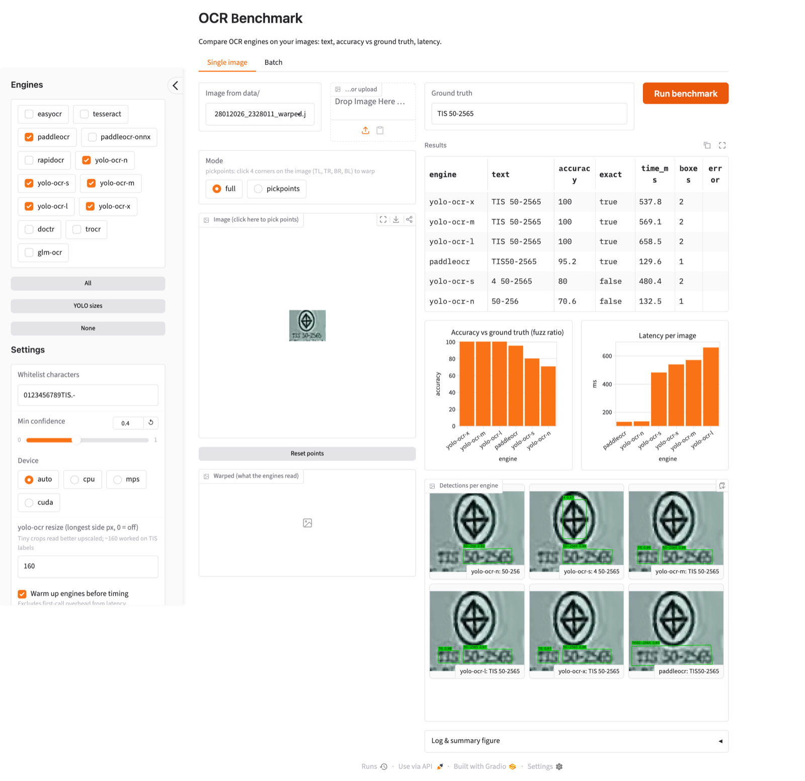

# ocr_explore

Benchmark OCR engines side by side on the same image: what text each one reads, how close it gets to the ground truth, and how long it takes. Built for reading short printed strings such as standard marks (`TIS 50-2565`) and date/time stamps on product photos, but it works on any image.

> **Research purposes only.** This repository is an exploratory research project for evaluating OCR approaches. It is not a production system, and results on our small test set should not be taken as general claims about any engine. Each engine and model used here keeps its own license (for example, Ultralytics is AGPL-3.0); check those before using them outside research.



It has two ways to use it:

- **Dashboard** (`ocr_dashboard.py`): a local web app for single-image comparison, 4-point perspective correction by clicking on the image, and batch runs over a labeled folder.
- **CLI** (`benchmark_ocr.py`): one image in, a printed comparison and a summary figure out.

## Engines

| Engine name | What it is |
|---|---|
| `easyocr` | EasyOCR (Thai + English) |
| `tesseract` | Tesseract via pytesseract (`--psm 6`, English) |
| `paddleocr` | PaddleOCR, PP-OCRv5 server detection + recognition |
| `paddleocr-onnx` / `rapidocr` | PP-OCRv5 server models in ONNX, run through RapidOCR |
| `yolo-ocr-n` … `yolo-ocr-x` | Ultralytics YOLO26-Text detector (5 sizes) + PP-OCRv6 medium recognizer |
| `doctr` | docTR (FAST detector + CRNN recognizer) |
| `trocr` | Microsoft TrOCR base-printed (single line) |
| `glm-ocr` | GLM-OCR vision-language model (see [Known issues](#known-issues)) |

Accuracy is `rapidfuzz.fuzz.ratio` (0–100) between the ground truth and the engine's text after the optional character whitelist. The dashboard also reports exact matches, ignoring whitespace.

## Setup

Requires **Python 3.11+** (the Ultralytics OCR recognizer needs it).

```bash
python -m venv .venv
source .venv/bin/activate
pip install torch torchvision          # pick the build for your platform: https://pytorch.org
pip install -r requirements.txt
brew install tesseract                 # or: sudo apt install tesseract-ocr
```

On a CUDA machine, install `onnxruntime-gpu` (>= 1.26) instead of `onnxruntime`.

Model weights download on first use:

- PaddleOCR → `~/.paddlex/`
- docTR → `~/.cache/doctr/`
- TrOCR / GLM-OCR → Hugging Face cache
- YOLO OCR → `models/for_yolo_ocr/` (git-ignored)
- RapidOCR's ONNX models are committed in `models/for_rapidocr/`

## Dashboard

```bash
python ocr_dashboard.py --open        # http://127.0.0.1:7860, Ctrl+C to stop
```

Options: `--port 8000`, `--host 0.0.0.0` (reachable from other machines on your network).

**Sidebar:** choose engines (quick buttons: All / YOLO sizes / None), character whitelist, minimum confidence, device (`auto` / `cpu` / `mps` / `cuda`), YOLO resize, and warm-up. Warm-up runs each engine once untimed before timing it, so latency doesn't include first-call overhead.

**Single image tab**

1. Pick an image from `data/` or upload one.
2. Optional: switch mode to `pickpoints` and click the 4 corners of the text region in order top-left, top-right, bottom-right, bottom-left. The warped crop appears below and is what the engines read.
3. Enter the ground truth (optional) and press **Run benchmark**.

You get a results table sorted by accuracy, accuracy and latency bar charts, each engine's detections drawn on the image, and the summary figure saved to `output/`.

**Batch tab**

1. Load a folder. It defaults to `data/`, filtered to filenames containing `_warped`.
2. Fill in the `gt` column and press **Save labels**. Labels are stored as `ocr_labels.csv` in that folder and reloaded next time.
3. Press **Run batch**.

You get a per-engine summary (mean accuracy, exact matches, median/mean latency, errors), a table of each engine's text per image, and a CSV of every result in `output/batch_results_<timestamp>.csv`. Batch mode reads images as they are, without warping.

## CLI

```bash
# Whole image, all engines
python benchmark_ocr.py --input data/sample_warped.jpg --gt "TIS 50-2565"

# Click 4 corners in an OpenCV window to warp first (the warped image is saved next to the input)
python benchmark_ocr.py --mode pickpoints --input data/sample.jpg --gt "TIS 50-2565" \
  --whitelist '0123456789TIS.- '

# Only PaddleOCR and every YOLO size, warmed up, small crops upscaled to 160 px for YOLO
python benchmark_ocr.py --input data/sample_warped.jpg --gt "TIS 50-2565" \
  --engines paddleocr,yolo-ocr --warmup --yolo_ocr_resize 160
```

| Flag | Meaning |
|---|---|
| `--mode full\|pickpoints` | Read the whole image, or click 4 corners to warp first |
| `--input PATH` | Image to read (required) |
| `--gt TEXT` | Ground truth; enables accuracy scoring |
| `--whitelist CHARS` | Drop every character not in this set before scoring (a space counts as a character) |
| `--min_score F` | Minimum confidence per detected text (default 0.4) |
| `--engines a,b` | Run only these engines (default: all). `yolo-ocr` expands to all five sizes |
| `--skip_engines a,b` | Run everything except these |
| `--warmup` | Run each engine once untimed before timing it |
| `--yolo_ocr_resize N` | Resize so the longest side is N px before YOLO OCR (0 = off) |
| `--cpu` / `--gpu` / `--mps` | Force a device (default: CUDA, then MPS, then CPU) |

Output: one line per engine in the terminal, plus `output/ocr_results_<image>.png` with the input, detections and results.

## Notes on YOLO OCR

- **Tiny crops need upscaling.** Ultralytics never upscales the input, so a 60×70 px crop reaches the detector at about 96 px. On small label crops, a longest side of ~160 px (`--yolo_ocr_resize 160`) worked best in our tests. Going much larger (320 px or more) made the detector find nothing.
- **Bigger isn't always better.** On a single TIS label at 160 px, the `m`, `l` and `x` sizes read the string exactly, while `n` and `s` dropped or added characters. Run the batch tab on labeled data before choosing a size.
- **Character set.** The default PP-OCRv6 recognizer covers Latin, Chinese and Japanese. It does **not** include Thai; Thai text needs a PP-OCRv5 Thai recognizer.
- **The recognizer runs on CPU** unless CUDA is available; only the detector uses MPS on a Mac.

## Other scripts

| Script | Purpose |
|---|---|
| `pickpoints_ocr.py` | Older single-engine version: click 4 corners, warp, OCR with one engine (`--ocr_engine easy\|tesseract\|paddle\|rapid\|doctr\|trocr`) |
| `extract_video_script.py` | Save frames from a video every N seconds (`--video`, `--every`, `--start`, `--end`, `--max_frames`, `--output`) to build test images |
| `test_paddleocr.py` | Minimal PaddleOCR example |
| `models/ocr_doctr.py`, `models/ocr_glm.py` | docTR and GLM-OCR wrappers used by the benchmark |

## Project layout

```
benchmark_ocr.py        engines, benchmark runner, CLI
ocr_dashboard.py        Gradio dashboard
models/                 engine wrappers and local model files
  for_rapidocr/         PP-OCRv5 ONNX models for RapidOCR
  for_yolo_ocr/         YOLO26-Text + PP-OCRv6 weights (downloaded, git-ignored)
data/                   your test images and ocr_labels.csv (git-ignored)
output/                 figures and batch CSVs (git-ignored)
```

`data/` is not in the repository. Put your own images there, or point the dashboard's batch tab at any folder.

## Known issues

- **GLM-OCR does not load** with the current `transformers` version (`Unrecognized configuration class GlmOcrConfig`). It is deselected by default in the dashboard; skip it on the CLI with `--skip_engines glm-ocr`.
- **PaddleOCR on a Mac runs on CPU**, because PaddleX doesn't support MPS.
- **Keep `huggingface-hub` below 2.0.** Gradio needs ≥ 1.16 and transformers/docTR need < 2.0; `requirements.txt` pins the working range.
